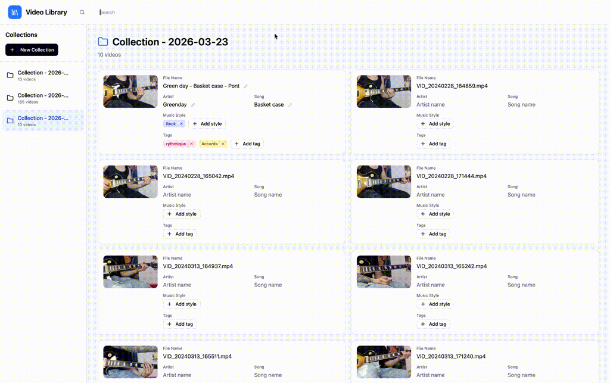

# Alexandria

I needed a simple app to search for videos my guitar teacher, John, records every week when he teaches me new songs, technics...
So I built this app.

The purpose of this app is to build video collections and search for videos.

The search engine is built up upon natural language processing (kind of) and uses the following information registered on videos:

- Video title
- Artist
- Song
- Style
- Tags

Below you have gifs showing the app in action.

- [How to create a collection](#create-a-collection-)
- [How to search for videos](#video-search)

## Stack

Alexandria is a [Tauri 2](https://tauri.app) desktop app: a **Rust** core
(domain, storage, full-text search with Tantivy) and a **Svelte 5 + TypeScript**
UI styled with **Tailwind CSS v4**. See [`doc/ARCHITECTURE.md`](doc/ARCHITECTURE.md)
for how the layers fit together and how the frontend talks to the Rust backend.

## Development

### Install `pre-commit` `hook`

```shell
$ chmod +x .githooks/pre-commit
$ git config core.hooksPath .githooks
```

### Run tests

#### Run all tests

```shell
pnpm run test
```

#### Run front tests

```shell
pnpm run test:front
```

#### Run Tauri tests

```shell
pnpm run test:back
```

### Run application during dev

Run the full desktop app (starts Vite, then opens the Tauri window):

```shell
pnpm run dev:start
```

To run only the web frontend in a browser (no Rust backend):

```shell
pnpm run dev
```

### Build app

```shell
pnpm run build
```

## Usage

### Create a collection


### Video search



### Where is my data stored?

Depending on your OS, your data is stored in:

- Windows: `C:\Users\<User>\AppData\Roaming\alexandria\collections`
- Linux: `~/.local/share/alexandria/collections`
- MacOS: `~/Library/Application Support/alexandria/collections`

You will find various JSON files containing your collections :

- You can delete them if you want to start fresh.
- You can edit them to add videos to your collections or merge various collections.
- And more importantly, you can copy / paste them in another location to save them (and later move them to back to their original location)
